<div align="center">

# Awesome Streamlit Theme Studio

**A visual theme editor for Streamlit, built with Streamlit.**

Start with one of ten themes. Make it yours. Take a complete theme package to your own app.

**[Run the Studio](#run-locally)** &nbsp; · &nbsp; **[Explore the themes](#ten-starting-points)** &nbsp; · &nbsp; **[Use your theme](#use-your-theme)**

Streamlit **1.66.1** · Python **3.13** · Open source

Built by [Max Braglia](https://maxbraglia.com/)

</div>

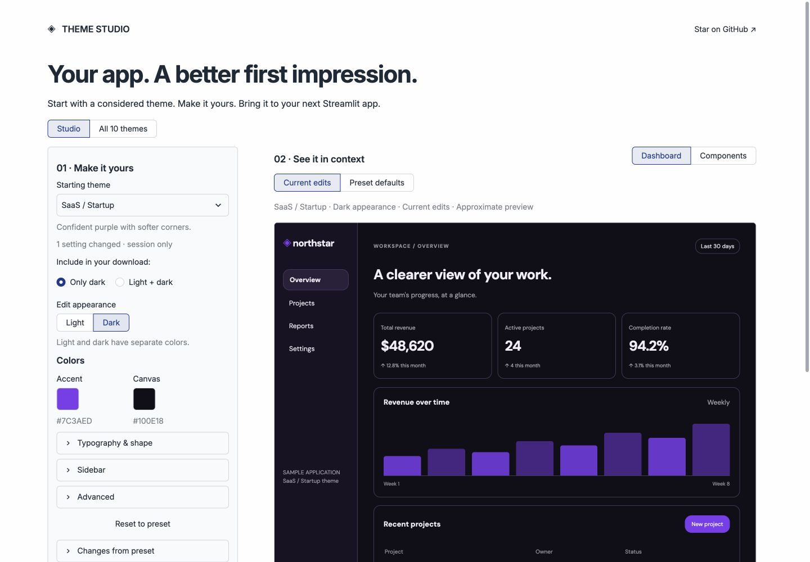

> The hosted Studio is not published yet. Run the same application locally below; the live link will appear here after release verification.

## Your app, with your theme

| Start with a design | Make a few changes | Take it with you |
|---|---|---|
| Ten distinct starting points, from Financial to Cyberpunk. | Accent and canvas up front. Typography, sidebar and additional styling stay tucked away until needed. | Copy the TOML or download a ZIP with configuration, referenced fonts, licenses and install steps. |

- **Light, dark, or both.** Edit the two palettes independently; download one appearance or a switchable pair.
- **Compare without losing your work.** Preview the preset, return to your edits, or reset. Switching presets asks before discarding changes.
- **Try real app contexts.** Dashboard and Components previews show metrics, charts, tables, forms, headings and code.
- **Keep it local.** No account, API key or database. Clone it, fork it, run it, change it.

The preview is an isolated HTML/CSS approximation. Native widgets, chart palettes, font scaling and responsive behavior can differ; the exported packages are also checked in native Streamlit samples.

## Ten starting points

Every theme supports the same editor, both appearances and a no-edit export. Each keeps its own typography and character. Studio defaults include small contrast refinements; the original collection stays available separately.

| | | |
|:--|:--|:--|
| 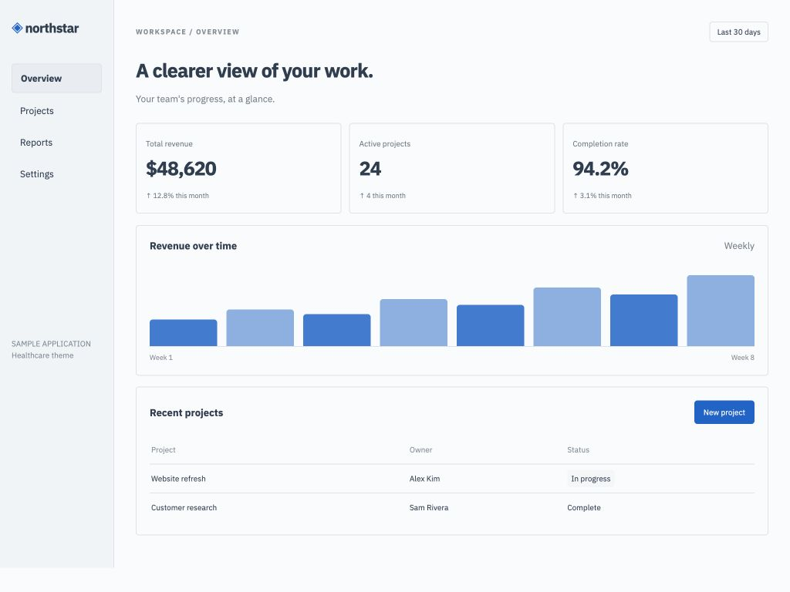 **Healthcare** · calm blue, IBM Plex | 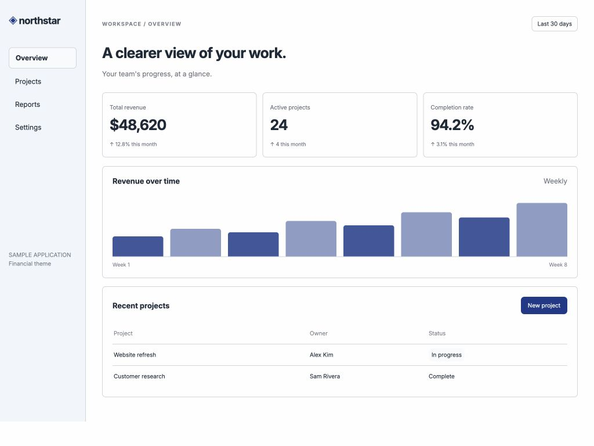 **Financial** · navy, Inter | 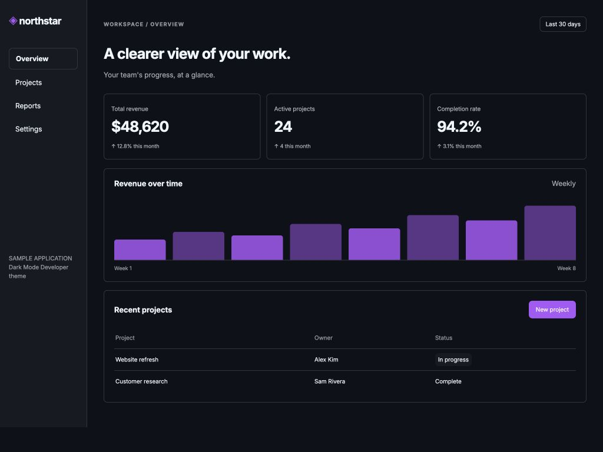 **Dark Mode Developer** · charcoal and purple |
| 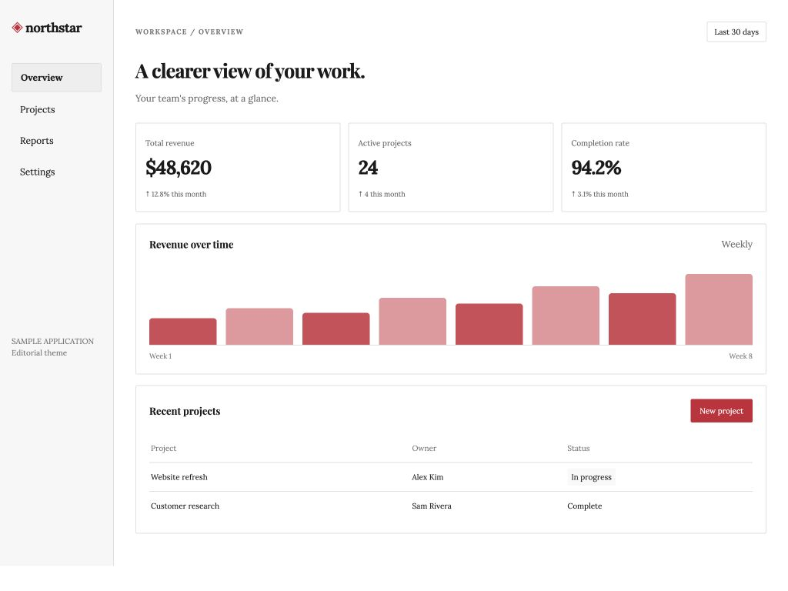 **Editorial** · Lora and Playfair Display | 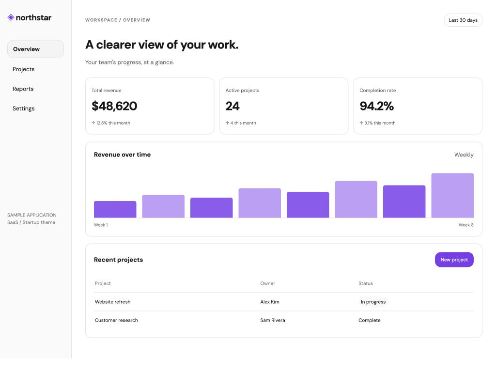 **SaaS / Startup** · violet, DM Sans | 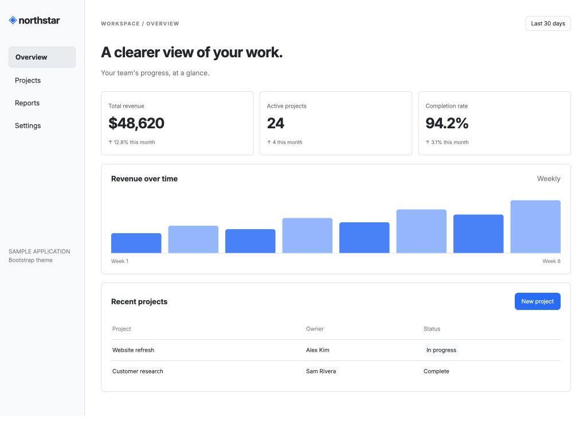 **Bootstrap** · familiar blue |
| 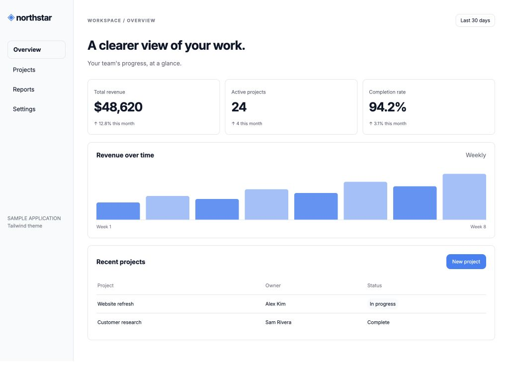 **Tailwind** · slate, Inter | 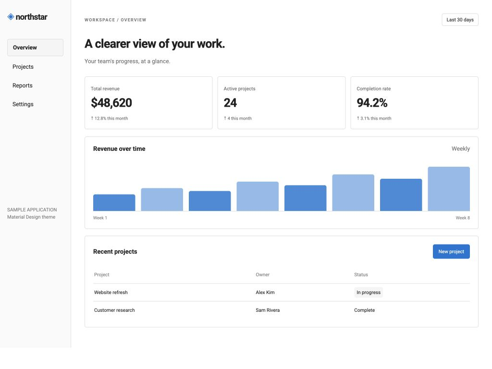 **Material Design** · blue, Roboto | 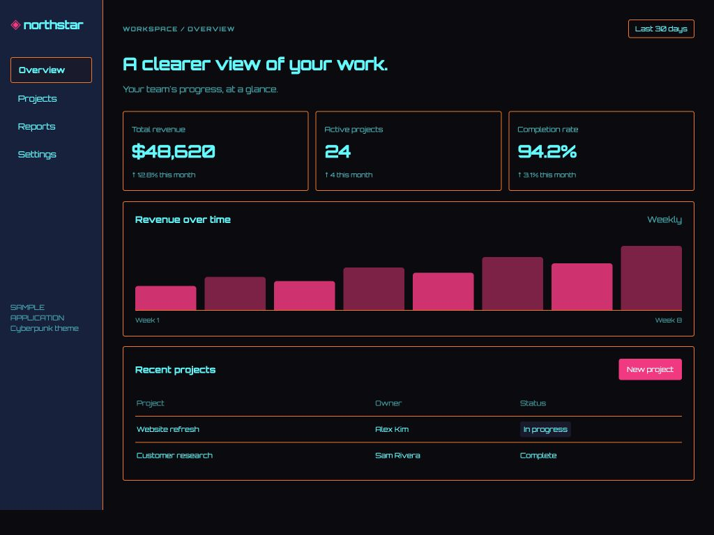 **Cyberpunk** · hot pink, cyan, Orbitron |
| 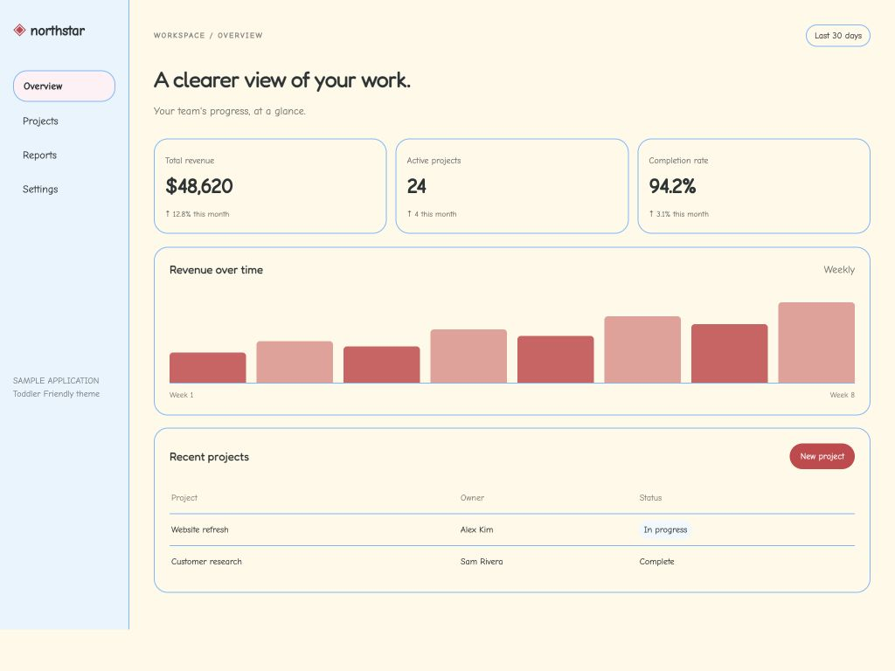 **Toddler Friendly** · warm colors, Comic Neue and Fredoka | | |

These are screenshots of the Studio's default Dashboard preview, using the bundled fonts and synthetic data.

## Run locally

Use **Python 3.13**. From a terminal:

```bash
git clone https://github.com/jmedia65/awesome-streamlit-themes.git
cd awesome-streamlit-themes
python3.13 -m venv .venv
source .venv/bin/activate
python -m pip install -r requirements.txt
python -m studio
```

On Windows, create the environment with `py -3.13 -m venv .venv` and activate it with `.venv\Scripts\Activate.ps1`.

Open **http://localhost:8501**. The launcher prepares the fixed workspace's bundled fonts and loads its own configuration. Your theme edits stay in your browser session and never overwrite the Studio's shared theme. Download your work before leaving or refreshing.

## Use your theme

1. Choose a theme and select **Light** or **Dark**. Edit as much or as little as you need.
2. Leave **Only light / Only dark** selected for that appearance, or choose **Light + dark** to include both.
3. Select **Download package**. The configuration's copy button is under **Configuration & installation**.

Unzip the package into your Streamlit project's root:

```text
your-app/
├── .streamlit/config.toml
├── static/                  # Only the referenced font files
├── licenses/                # Font licenses and notices
├── LICENSE
├── README.md                # Installation steps
└── your_app.py
```

Back up an existing config before replacing it. Keep the package's folders together, then run:

```bash
streamlit run your_app.py
```

Restart Streamlit after configuration/font changes. For paired output, open your app's top-right **⋮ menu** and choose **Light** or **Dark**. The `app/static/…` URLs in the config map to the package's `static/` directory; you do not need to clone this repository to use an exported theme.

Tested target: **Streamlit 1.66.1 / Python 3.13.12**. This is the verified runtime, not a promise of compatibility with every Streamlit version. Missing assets or notices block broken packages; contrast concerns are advisory.

## Original themes and standalone demos

Looking for the original collection? [Browse the configurations, fonts and standalone demos](themes/README.md). That page also links to the exact pre-Studio repository snapshot. The original source, configurations, font binaries and notices are preserved; their folders now live under `themes/`.

## Development

```bash
python -m pip install -r studio/requirements-dev.txt
python scripts/audit_baseline.py
python -m pytest -q
```

The suite covers the original demos, all-ten export/package integrity, native sample installs, shared vs per-mode settings, session isolation, reset and protected preset switching. See [Studio development details](studio/README.md) for the sample app and preview limitations.

[Report an issue](https://github.com/jmedia65/awesome-streamlit-themes/issues) with the tested version, preset and steps to reproduce. Please omit secrets and private data.

## Credits and licenses

Built on [Streamlit's theming system](https://docs.streamlit.io/develop/concepts/configuration/theming), inspired by [Thiago Teixeira's introduction](https://x.com/ThiagoTDotCom/status/1934679204320432283). Original demo applications are adapted from Streamlit's Anthropic-inspired example and retain Apache 2.0 attribution. Bundled Google Fonts retain their SIL Open Font Licenses.

See [LICENSE](LICENSE), [third-party notices](THIRD_PARTY_NOTICES.md) and [font notices](licenses/FONT_NOTICES.md). Code/configuration licensing does not replace the fonts' licenses.
