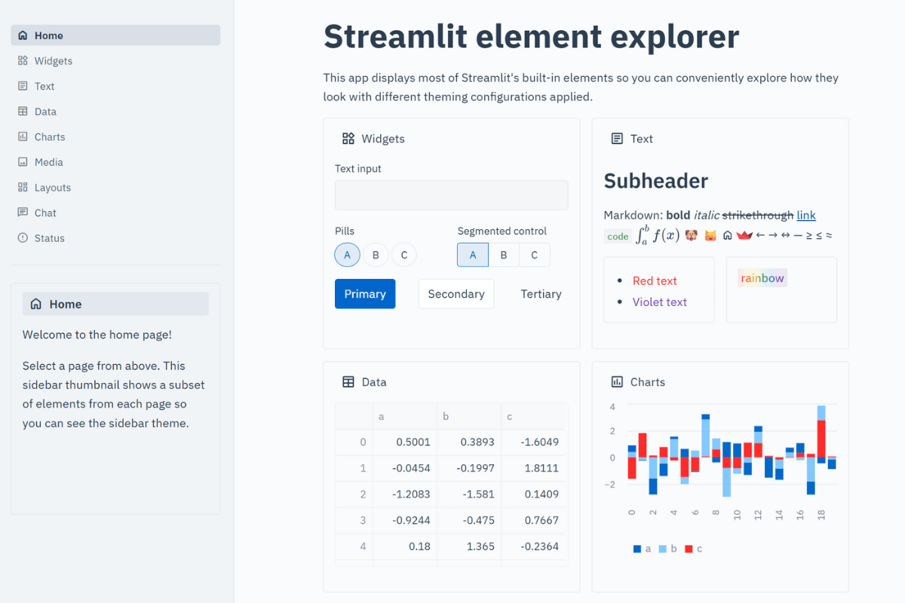

# 🏥 Healthcare Theme

**Clinical-grade design for medical and healthcare applications!**

When patient data and medical insights need professional presentation, this theme delivers the trust and accessibility required for healthcare environments. Clean, clinical, and credible - perfect for medical institutions and healthcare technology! 🩺✨



## 🔥 What Makes This Theme Special

This theme embodies the professionalism and trustworthiness essential for healthcare applications:

**💙 Medical Blue Primary** (#0066cc) - Professional blue commonly associated with healthcare  
**🧼 Clinical White Background** - Clean, sterile, professional atmosphere  
**📊 High Contrast Text** - Designed for clear readability in professional environments  
**🔲 Minimal Rounding** - Sharp, precise edges for professional appearance  
**⚕️ IBM Plex Typography** - Enterprise font designed for business applications  
**🩹 Soft Borders** - Gentle definition without being harsh

## 🎯 Perfect For

- **Electronic Health Records (EHR)** dashboards and interfaces
- **Medical research** data analysis and visualization
- **Hospital management** systems and operational tools
- **Telemedicine platforms** and patient portals
- **Clinical trial reporting** and pharmaceutical research
- **Patient monitoring** dashboards and real-time data
- **Medical billing** and insurance management tools
- **Public health** analytics and epidemiological studies

## 🚀 Quick Start

```bash
# Clone the entire repo to see all themes
git clone https://github.com/jmedia65/awesome-streamlit-themes.git
cd awesome-streamlit-themes

# Install dependencies
pip install -r themes/requirements-legacy.txt

# Navigate to healthcare theme and see it in action
cd themes/healthcare
streamlit run streamlit_app.py
```

**Love what you see?** Copy the theme to your project:

```bash
# Copy theme files to your Streamlit project
cp -r .streamlit/ /path/to/your/project/
cp -r static/ /path/to/your/project/
```

## 🛠️ Fonts Used

_All fonts are already included in the `static/` folder - no downloads needed!_

### IBM Plex Sans

- **Perfect for:** Professional healthcare interfaces and business applications
- **Used for:** Body text, headings, patient information displays
- **Source:** [Google Fonts - IBM Plex Sans](https://fonts.google.com/specimen/IBM+Plex+Sans)

### IBM Plex Mono

- **Perfect for:** Technical data display and precise information presentation
- **Used for:** Code snippets, data tables, medical ID numbers
- **Source:** [Google Fonts - IBM Plex Mono](https://fonts.google.com/specimen/IBM+Plex+Mono)

## 📁 Installation Steps

1. **Clone and explore** the theme first (see Quick Start above)
2. **Copy theme files** to your own Streamlit project:
   ```
   your-project/
   ├── .streamlit/
   │   └── config.toml          # ← Copy this!
   ├── static/                  # ← Copy this entire folder!
   │   ├── IBMPlexSans-Regular.ttf
   │   ├── IBMPlexSans-Medium.ttf
   │   ├── IBMPlexSans-SemiBold.ttf
   │   ├── IBMPlexSans-Bold.ttf
   │   ├── IBMPlexMono-Regular.ttf
   │   └── IBMPlexMono-SemiBold.ttf
   └── your_app.py
   ```
3. **Restart your Streamlit app** and enjoy the clinical professionalism!

## 🎨 Theme Configuration

The implementation happens in `.streamlit/config.toml`:

```toml
[theme]
primaryColor = "#0066cc"              # Professional medical blue
backgroundColor = "#fafbfc"           # Off-white - clinical clean but not harsh
secondaryBackgroundColor = "#f4f6f8"  # Light gray-blue - subtle professional feel
textColor = "#2c3e50"                 # Dark blue-gray - highly readable
linkColor = "#0052a3"                 # Darker medical blue for links
borderColor = "#dee2e6"               # Soft gray borders - clean definition
```

## 🏆 The Professional Healthcare Difference

This theme creates the visual impression of professional medical software designed for critical healthcare applications.

Perfect for:

- **Medical research platforms** - Academic credibility and professionalism
- **Healthcare compliance tools** - Professional appearance for regulatory environments
- **Clinical decision support** - Clean, distraction-free environment
- **Patient-facing applications** - Professional appearance that builds confidence

## 💡 Why Healthcare-Focused Design Matters

✅ **Clinical Clarity** - High contrast design supports accurate data reading  
✅ **Professional Appearance** - Color scheme and typography choices convey seriousness  
✅ **Accessibility Considerations** - Designed with readability and usability in mind  
✅ **Trust Building** - Professional medical aesthetic helps establish credibility  
✅ **Clean Interface** - Minimal design reduces visual distractions from important data

## 🎯 Pro Tips

- **Perfect for patient-facing tools** - professional appearance builds trust
- **Great for clinical workflows** - clean design supports focused work
- **Ideal for medical data visualization** - neutral background highlights important information
- **Excellent for telehealth platforms** - professional yet approachable appearance

---

**Built with ⚕️ for healthcare applications**  
_Where patient trust and clinical precision matter most_ 🏥
