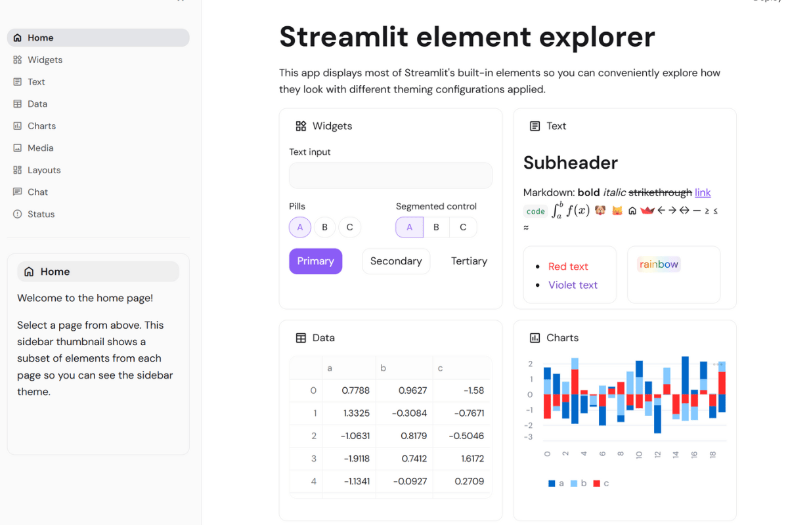

# 🚀 SaaS/Startup Theme

**Modern, growth-focused design for contemporary internal tools!**

When your internal dashboards need to match the energy and polish of modern technology companies, this theme delivers. Clean, sophisticated, and trendy - perfect for making internal tools feel current and professional! 💜✨



## 🔥 What Makes This Theme Special

This theme captures the aesthetic commonly found in modern startup and SaaS applications:

**💜 Modern Purple Primary** (#8b5cf6) - Contemporary color choice popular in modern interfaces  
**✨ Generous Border Radius** (0.75rem) - Friendly, modern, approachable interface design  
**🎯 DM Sans Typography** - Clean, modern font popular in contemporary web design  
**⚡ Clean Contrast** - High-performance readability for data-heavy dashboards  
**🔮 Developer-First Code Font** - Fira Code with beautiful ligatures  
**🌟 Modern Spacing** - Contemporary, breathable, energetic layout

## 🎯 Perfect For

- **Internal analytics dashboards** and growth metrics platforms
- **Customer success tools** and user engagement tracking
- **A/B testing interfaces** and experiment management
- **Revenue tracking systems** and financial KPI dashboards
- **Product usage analytics** and user behavior insights
- **Team performance tools** and productivity metrics
- **Marketing automation** dashboards and campaign analysis
- **Sales pipeline management** and conversion tracking

## 🚀 Quick Start

```bash
# Clone the entire repo to see all themes
git clone https://github.com/jmedia65/awesome-streamlit-themes.git
cd awesome-streamlit-themes

# Install dependencies
pip install -r themes/requirements-legacy.txt

# Navigate to saas-startup theme and see it in action
cd themes/saas-startup
streamlit run streamlit_app.py
```

**Love what you see?** Copy the theme to your project:

```bash
# Copy theme files to your Streamlit project
cp -r .streamlit/ /path/to/your/project/
cp -r static/ /path/to/your/project/
```

## 🛠️ Fonts Used

_All fonts are already included in the `static/` folder - no downloads needed!_

### DM Sans (Modern Web Typography)

- **Perfect for:** Contemporary startup-style interfaces and modern web design
- **Used for:** Body text, headings, interface elements
- **Source:** [Google Fonts - DM Sans](https://fonts.google.com/specimen/DM+Sans)

### Fira Code (Developer-Friendly Monospace)

- **Perfect for:** Code display with ligatures and modern monospace design
- **Used for:** Code snippets, technical data, developer-focused content
- **Source:** [Google Fonts - Fira Code](https://fonts.google.com/specimen/Fira+Code)

## 📁 Installation Steps

1. **Clone and explore** the theme first (see Quick Start above)
2. **Copy theme files** to your own Streamlit project:
   ```
   your-project/
   ├── .streamlit/
   │   └── config.toml          # ← Copy this!
   ├── static/                  # ← Copy this entire folder!
   │   ├── DMSans-Regular.ttf
   │   ├── DMSans-Medium.ttf
   │   ├── DMSans-SemiBold.ttf
   │   ├── DMSans-Bold.ttf
   │   ├── FiraCode-Regular.ttf
   │   └── FiraCode-Medium.ttf
   └── your_app.py
   ```
3. **Restart your Streamlit app** and enjoy the modern aesthetic!

## 🎨 Theme Configuration

The implementation happens in `.streamlit/config.toml`:

```toml
[theme]
primaryColor = "#8b5cf6"              # Purple-500 - modern, trendy color choice
backgroundColor = "#ffffff"           # Pure white - clean, modern foundation
secondaryBackgroundColor = "#fafafa"  # Neutral-50 - subtle modern gray
textColor = "#18181b"                 # Zinc-900 - high contrast, modern
linkColor = "#7c3aed"                 # Purple-600 - slightly darker for links
borderColor = "#e4e4e7"               # Zinc-200 - clean, modern borders
```

## 🏆 The Modern Professional Factor

This theme makes any Streamlit app feel contemporary and professionally designed. It has that perfect balance of:

- **Professional enough** for business presentations
- **Modern enough** for tech-savvy teams
- **Clean enough** for data-heavy interfaces
- **Approachable enough** for cross-functional collaboration

Your colleagues will notice the professional, modern appearance that stands out from default styling!

## 💡 Why Modern Startup-Inspired Design Works

✅ **Contemporary Appeal** - Purple and rounded design elements feel current  
✅ **Professional Appearance** - Clean typography and spacing convey competence  
✅ **Developer-Friendly** - Font choices and color scheme appeal to technical teams  
✅ **Versatile Use** - Appropriate for both internal tools and presentations  
✅ **Visual Hierarchy** - Clear contrast and spacing support data comprehension  
✅ **Scalable Design** - Works well for simple dashboards and complex applications

## 🎯 Pro Tips

- **Perfect for growth teams** - modern appearance supports data-focused work
- **Great for internal tools** - contemporary design encourages regular use
- **Ideal for customer success** - professional appearance suitable for client-facing contexts
- **Excellent for product analytics** - clean background highlights important insights

---

**Built with 🚀 for teams that value modern, professional design**  
_Making internal tools as polished as the products you ship_ 💜
